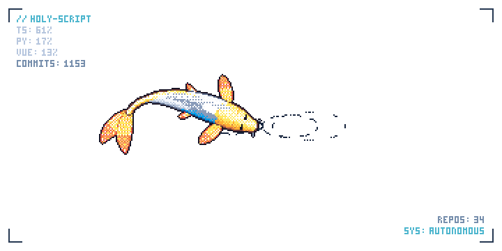

  

  <em>🌊 The koi swims based on yesterday's commit activity, updated nightly via GitHub Actions.</em>

# Hey, I'm Palash 👋

I'm a full-stack developer building autonomous AI agents and responsive web platforms. Right now, I'm mostly focused on multi-agent orchestration, local LLMs, and building systems that actually ship to production.

  
  
  

---

### 🔨 What I'm Building

A couple of things I've been hacking on recently (more pinned below):

- **[The Fabric](https://github.com/holy-script/fabric)** — A personal operating system that connects wearable bio-telemetry, background daemons, and an interactive knowledge graph. *(Check out the [live cockpit](https://fabric-one-sage.vercel.app))*
- **[QAgent](https://github.com/holy-script/QAgent)** — An autonomous QA agent that navigates web apps, hunts bugs, and generates test reports using LangGraph and Playwright.

---

### 🧰 Tools & Tech

- **AI & Agents:** LangChain, LangGraph, Ollama, Claude & OpenAI APIs, AWS Bedrock
- **Frontend & Full-Stack:** Next.js, React, TypeScript, Tailwind CSS, Node.js
- **Backend & Data:** Python (FastAPI), PostgreSQL, Redis, Supabase, SQLite
- **DevOps & Tooling:** Docker, Linux, GitHub Actions, Playwright, Git

---

### 📊 Stats

  
  &nbsp;
  

---

### ⚡ Fun Fact

I'm a performing ventriloquist 🗣️ (yes, really). It's great for live stage shows, speaking at events, and throwing voices on Zoom calls.

Always down to talk agents, LLMs, or collaborate on cool projects — feel free to drop me an email at [palashjohricool@gmail.com](mailto:palashjohricool@gmail.com) or connect on [LinkedIn](https://linkedin.com/in/palash-johri-3301)!
